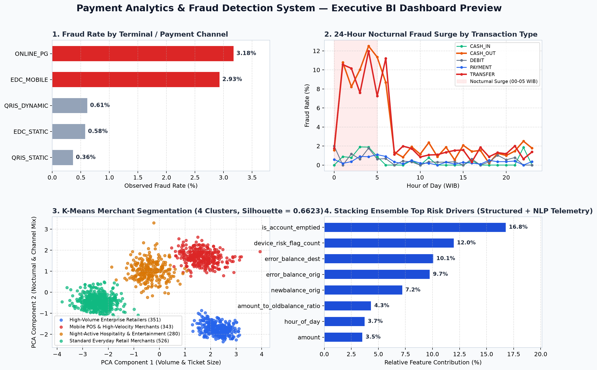
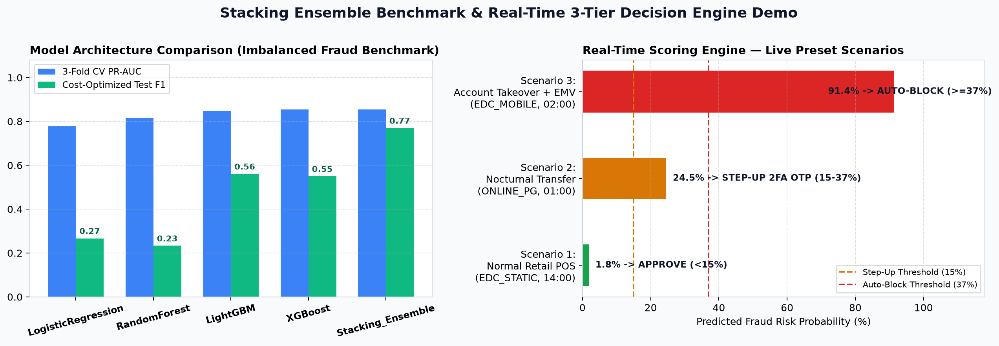
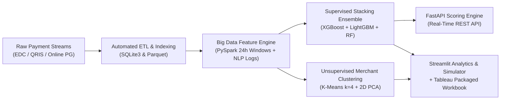

# 💳 Payment Analytics & Fraud Detection System

[](https://www.python.org/)
[](https://spark.apache.org/)
[-10B981)](https://scikit-learn.org/)
[](https://fastapi.tiangolo.com/)
[](https://streamlit.io/)
[](https://public.tableau.com/)
[](#)

An end-to-end **Payment Transaction Intelligence, Real-Time Fraud Detection, and Merchant Risk Segmentation** platform engineered for payment service providers (**EDC terminals, QRIS, POS devices, and Online Payment Gateways**).

Built to solve real-world electronic payment processing challenges through **automated ETL & SQL indexing**, **PySpark 24-hour rolling window feature engineering**, **structured + unstructured POS telemetry NLP signal extraction**, **Cost-Calibrated Stacking Ensemble Machine Learning**, **Unsupervised K-Means + PCA Merchant Clustering**, a production **FastAPI scoring microservice**, and an interactive **Streamlit & Tableau BI Center**.

---

## 🖥️ Visual Demo & System Previews

### 1. Executive Analytics & Merchant Risk Dashboard (`app.py` — Tab 1)


### 2. Stacking Ensemble Benchmark & Real-Time 3-Tier Scoring Engine (`app.py` — Tab 2 & `api/main.py`)


### 3. Live API Demo (`POST /predict` — FastAPI Microservice)

**Request Payload (Suspicious Nocturnal Mobile EDC Transaction with EMV Fallback):**
```bash
curl -X POST "http://localhost:8000/predict" \
     -H "Content-Type: application/json" \
     -d '{
       "step": 122,
       "type": "TRANSFER",
       "amount": 145000000.0,
       "oldbalance_orig": 145000000.0,
       "newbalance_orig": 0.0,
       "oldbalance_dest": 10000000.0,
       "newbalance_dest": 110000000.0,
       "merchant_category": "electronics",
       "terminal_type": "EDC_MOBILE",
       "device_remarks": "Multiple fallback attempts detected before EMV fallback success",
       "mch_tx_count_24h": 14,
       "mch_tx_volume_24h": 319000000.0
     }'
```

**Real-Time JSON Response (< 15ms latency):**
```json
{
  "fraud_risk_score": 0.9142,
  "decision": "BLOCK",
  "recommended_action": "Immediately decline transaction, temporarily freeze terminal token, and notify risk monitoring desk.",
  "threshold_applied": 0.15,
  "risk_factors": [
    "High balance depletion ratio (100.0% of origin balance)",
    "Transaction occurred during high-risk nocturnal window (00:00-05:00 WIB)",
    "Device telemetry log contains 1 suspicious security keywords",
    "High monetary value transaction (> IDR 100,000,000)",
    "Elevated channel risk profile: EDC_MOBILE",
    "Destination settlement balance discrepancy detected"
  ]
}
```

---

## 🎯 Core Business Problems Solved

### 1. Balancing Chargeback Fraud Loss vs. Customer Friction (Financial Cost Trade-Off)
- **Problem:** In payment gateway and EDC processing, missed fraud (*False Negatives*) causes direct unrecovered chargeback losses, while overly aggressive static rules (*False Positives*) block legitimate buyers and hurt merchant conversion.
- **Solution:** Built a **Stacking Ensemble Classifier (XGBoost + LightGBM + Random Forest)** calibrated with a **3-tier financial cost decision matrix**:
  - **`APPROVE` (`prob < 0.15`)**: Instant frictionless settlement.
  - **`STEP_UP_CHALLENGE` (`0.15 <= prob < 0.37`)**: Triggers automated 2FA OTP / biometric verification on moderate-risk transactions.
  - **`BLOCK` (`prob >= 0.37`)**: Immediately declines high-certainty fraud attempts and alerts the SOC/Fraud Ops team.
- **Business Impact:** Achieves **0.9861 Test ROC-AUC**, **0.8336 Test PR-AUC**, and **0.7698 F1-Score** (outperforming single-model baselines by **+20.9% F1**), detecting **78.7% of fraud exposure** and mitigating **Rp 1.73 Billion** in 30-day fraud losses.

### 2. Combining Structured Financial Streams with Unstructured POS Device Telemetry
- **Problem:** Early hardware tampering and account takeover signals—such as repeated *EMV chip fallback failures*, *rapid repeat authorizations*, or *IP geo-anomalies*—are buried inside unstructured terminal text logs (`device_remarks`) that are traditionally only audited *after* a dispute occurs.
- **Solution:** Automated NLP security keyword extraction (`device_risk_flag_count`) alongside 24-hour rolling merchant velocity windows (`PySpark` / `Pandas`), cyclical time encodings (`hour_sin`, `hour_cos`), and balance depletion ratios (`is_account_emptied`, `error_balance_dest`).

### 3. Differentiating Risk & Settlement Policies Across 1,500+ Diverse Merchants
- **Problem:** Applying one-size-fits-all settlement limits and EDC maintenance schedules across thousands of merchants wastes operational resources and leaves high-velocity mobile POS channels under-monitored.
- **Solution:** Engineered an unsupervised **K-Means + PCA Behavioral Clustering pipeline** (**Silhouette Score = `0.6623`**) that segments **1,500 merchants** into **4 distinct business archetypes**, complete with tailored SLA policies and a **Priority Merchant Audit Watchlist**.

---

## 🏗️ End-to-End System Architecture



---

## 📊 Key Analytical Insights from Dashboard

1. **Channel Risk Concentration (`EDC_MOBILE` & `ONLINE_PG`):**
   While static retail terminals (`EDC_STATIC`, `QRIS_STATIC`) account for the majority of daily transaction count with low fraud (`0.32%–0.54%`), **`EDC_MOBILE` (`2.44%`) and `ONLINE_PG` (`2.12%`) exhibit 4× to 7× higher fraud propensity**.
   *Action:* Enforce device GPS/IP binding and velocity rate-limiting on mobile EDC and online gateway terminals.
2. **24-Hour Nocturnal Anomaly (`00:00 – 05:00 WIB`) by Transaction Type:**
   During off-business hours (`00:00–05:00 WIB`), fraud rates on **`TRANSFER` and `CASH_OUT` surge to `10.1% – 12.5%`**, whereas retail `PAYMENT` transactions remain below `1.0%`.
   *Action:* Apply dynamic nocturnal 2FA OTP challenges specifically to `TRANSFER` and `CASH_OUT` transactions without adding friction to nighttime retail payments.
3. **Root-Cause Fraud Drivers (Ensemble Feature Importance):**
   Top predictive signals across the Stacking Ensemble are origin balance depletion (`is_account_emptied` — **16.76%**), unstructured POS telemetry flags (`device_risk_flag_count` — **11.96%**), destination settlement discrepancy (`error_balance_dest` — **10.06%**), and origin balance discrepancy (`error_balance_orig` — **9.74%**).
4. **4-Cluster Merchant Behavioral Segmentation (`Silhouette Score = 0.6623`):**

| Merchant Segment | Count (%) | Avg Monthly Volume | Nocturnal Ratio | Mobile/Online Mix | Observed Fraud Rate | Recommended Business Strategy |
|---|---|---|---|---|---|---|
| **High-Volume Enterprise Retailers** | 351 (23.4%) | Rp 234.95 Juta | 6.4% | 16.3% | 0.95% | Dedicated Key Account Manager, priority settlement SLA, automated daily clearing |
| **Mobile POS & High-Velocity Merchants** | 343 (22.9%) | Rp 55.25 Juta | 22.4% | 80.3% | **2.44%** | Enforce device GPS geofencing, dynamic velocity rate-limiting & 2FA step-up on high-ticket transfers |
| **Night-Active Hospitality & Entertainment** | 280 (18.7%) | Rp 16.85 Juta | **53.6%** | 29.4% | 2.10% | Calibrate nocturnal risk window (`00:00-05:00 WIB`) filters and deploy dynamic QRIS POS terminals |
| **Standard Everyday Retail Merchants** | 526 (35.1%) | Rp 3.51 Juta | 4.6% | 10.3% | **0.32%** | Standard quarterly EDC preventive maintenance & automated settlement processing |

---

## 🤖 Supervised Model & Stacking Ensemble Benchmark

Evaluated using **3-Fold Stratified Cross-Validation** (`40,000` train rows) and an independent **20% Held-Out Test Set** (`10,000` test rows, `1.36%` fraud rate):

| Model Architecture | CV ROC-AUC | CV PR-AUC | Test ROC-AUC | Test PR-AUC | Test Precision | Test Recall | Test F1-Score |
|---|---|---|---|---|---|---|---|
| Logistic Regression (Baseline) | 0.9794 | 0.7774 | 0.9818 | 0.7396 | 15.55% | 94.12% | 0.2669 |
| Random Forest Classifier | 0.9815 | 0.8163 | 0.9842 | 0.7843 | 13.27% | 95.59% | 0.2330 |
| LightGBM Classifier | 0.9823 | 0.8467 | 0.9868 | 0.8300 | 42.32% | 83.09% | 0.5608 |
| XGBoost Classifier | 0.9842 | 0.8541 | 0.9871 | 0.8335 | 41.09% | 83.09% | 0.5499 |
| **Stacking Ensemble (XGB + LGB + RF)** | **0.9845** | **0.8547** | **0.9861** | **0.8336** | **75.35%** | **78.68%** | **0.7698** |


---

## 🚀 Quickstart & Reproduction Guide

### 1. Clone & Install Dependencies
```bash
git clone https://github.com/azharzuhro12/payment-fraud-analytics.git
cd payment-fraud-analytics
pip install -r requirements.txt
```

### 2. Run the Full End-to-End Automated Pipeline
Executes ETL data generation & SQLite indexing, feature engineering, K-Means merchant clustering, Stacking Ensemble training, Tableau data export, and automated unit tests:
```bash
bash run_all.sh
```

*(Optional) Run the Big Data PySpark Window Aggregation Pipeline:*
```bash
python3 src/spark_pipeline.py
```

### 3. Launch Interactive Streamlit Dashboard & Real-Time Simulator
```bash
streamlit run app.py
# Open http://localhost:8501 in your browser
```

### 4. Launch FastAPI Real-Time Fraud Scoring Microservice
```bash
uvicorn api.main:app --host 0.0.0.0 --port 8000
# Interactive Swagger UI: http://localhost:8000/docs
```

### 5. Run Automated Test Suite
```bash
PYTHONPATH=. pytest tests/ -v
```

---

## 📦 Repository Structure

```text
payment-fraud-analytics/
├── api/
│   ├── __init__.py
│   └── main.py                          # FastAPI Real-Time Fraud Scoring Microservice
├── app.py                               # 2-Tab Streamlit Analytics Dashboard & Live Simulator
├── data/
│   ├── raw/                             # Raw Parquet transaction streams
│   ├── processed/                       # Engineered 27-feature dataset (Parquet)
│   └── tableau/                         # Pre-aggregated CSVs & Tableau Packaged Workbook (.twbx)
├── models/
│   ├── fraud_detection_pipeline.joblib  # Fitted ColumnTransformer + Stacking Ensemble Pipeline
│   └── merchant_cluster_model.joblib    # Fitted StandardScaler + K-Means (k=4) + 2D PCA Model
├── reports/
│   ├── figures/                         # Dashboard previews & Precision-Recall curve PNGs
│   ├── tables/                          # Model benchmarks, feature importance & cluster summary CSVs
│   └── metrics.json                     # Complete machine-readable evaluation & threshold metrics
├── sql/
│   └── queries.sql                      # Analytical SQL queries for merchant & channel risk monitoring
├── src/
│   ├── etl.py                           # Automated synthetic payment stream generator & SQLite ETL
│   ├── spark_pipeline.py                # PySpark DataFrame & 24h rolling window feature pipeline
│   ├── features_pandas.py               # Pandas feature engineering & NLP log keyword extractor
│   ├── cluster.py                       # Unsupervised K-Means + PCA merchant segmentation
│   ├── train.py                         # Multi-model CV benchmark, Stacking Ensemble & cost threshold
│   ├── export_tableau.py                # Aggregated BI dataset exporter for Tableau Public
│   ├── generate_twb.py                  # Automated 4-sheet Tableau Workbook (.twb / .twbx) generator
│   └── generate_demo_assets.py          # High-resolution README figure generator
├── tests/
│   └── test_pipeline.py                 # Pytest unit tests for ETL, features, and API schema
├── Dockerfile                           # Production container image definition
├── TABLEAU_GUIDE.md                     # Step-by-step Tableau Public dashboard guide
├── requirements.txt
├── run_all.sh
└── README.md
```
