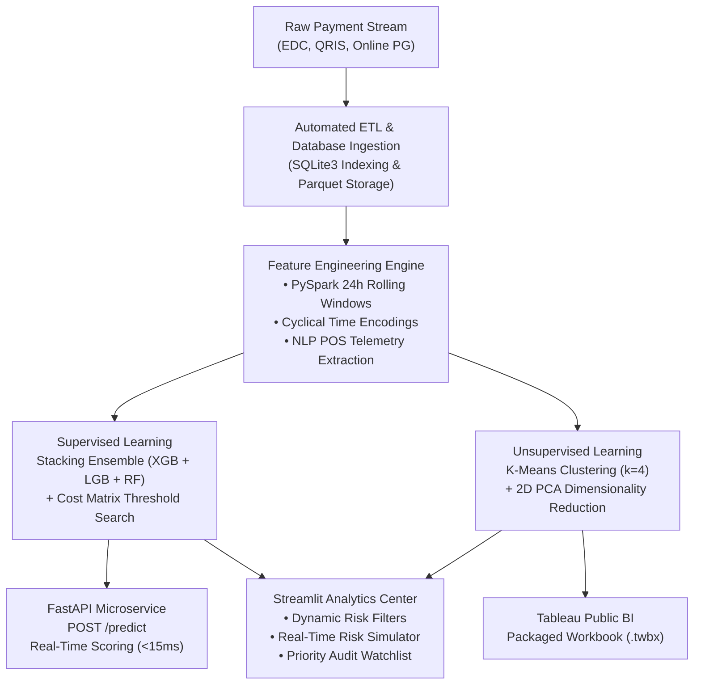
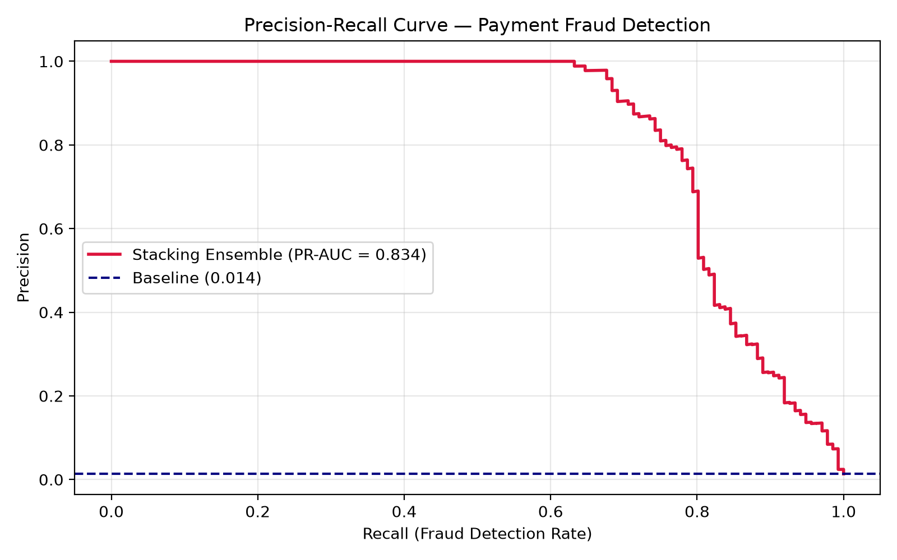

# Payment Analytics & Fraud Detection System

[](https://www.python.org/)
[](https://spark.apache.org/)
[-10B981)](https://scikit-learn.org/)
[](https://fastapi.tiangolo.com/)
[](https://streamlit.io/)
[](https://public.tableau.com/app/profile/azhar.zuhro/viz/PaymentAnalyticsFraudDetectionDashboard/aymentAnalyticsFraudDetectionDashboard)
[](https://www.docker.com/)
[](#)

---

## Demo

<p align="center">
  
</p>

- **Live Tableau Public Dashboard:** [Payment Analytics & Fraud Detection Dashboard — Tableau Public](https://public.tableau.com/app/profile/azhar.zuhro/viz/PaymentAnalyticsFraudDetectionDashboard/aymentAnalyticsFraudDetectionDashboard)

---

## Project Introduction & Overview

Platform intelijen transaksi pembayaran, deteksi fraud real-time, dan segmentasi risiko merchant terintegrasi yang dirancang untuk penyedia jasa pembayaran (**mesin EDC, QRIS, POS terminal, dan Online Payment Gateway**).

Platform ini mengolah **50.000 transaksi** dengan nilai settlement sebesar **Rp 107,98 Miliar** yang mencakup **1.500 merchant aktif**. Sistem memadukan analitik big data, rekayasa fitur sinyal terstruktur & tidak terstruktur (log telemetri POS), model machine learning **Stacking Ensemble**, dan segmentasi merchant **K-Means + PCA** guna memitigasi risiko fraud tanpa mengganggu kenyamanan transaksi pelanggan sah.

### Masalah Bisnis Utama yang Diselesaikan:
1. **Trade-Off Biaya Finansial Fraud vs. Friksi Pelanggan:** Mengganti aturan statis (*hard rule*) dengan model ensemble terkalibrasi matriks biaya untuk mengurangi kerugian *chargeback* sekaligus meminimalkan penolakan transaksi sah (*false positive*).
2. **Kombinasi Data Terstruktur & Log Teks Telemetri Perangkat:** Mengekstrak anomali perangkat keras EDC (*EMV fallback*, *rapid repeat authorization*) dari catatan teks log (`device_remarks`) menjadi sinyal prediktif real-time.
3. **Diferensiasi Kebijakan Risiko 1.500+ Merchant:** Mengelompokkan merchant berdasarkan profil volume, jam aktif, dan kanal terminal untuk menetapkan limit settlement serta jadwal pemeliharaan perangkat yang tepat sasaran.

---

## Key Features

- **Automated Data Ingestion & Indexing:** Pipeline ETL otomatis menyimpan data transaksi ke database SQLite & Parquet dengan skema indeks teroptimasi untuk kueri analitik cepat.
- **Big Data Feature Engineering (PySpark & Pandas):** Agregasi rolling window 24 jam per merchant (kecepatan & volume transaksi), fitur siklikal waktu transaksi (`sin`/`cos`), serta rasio pengurasan saldo akun.
- **Unstructured NLP Telemetry Extraction:** Ekstraksi otomatis kata kunci risiko keamanan dari catatan teks log telemetri terminal EDC/POS.
- **Stacking Ensemble Fraud Scoring:** Arsitektur ensemble menggabungkan **XGBoost**, **LightGBM**, dan **Random Forest** dengan meta-learner **Logistic Regression** untuk menangani ketimpangan kelas ekstrem (*imbalanced data*).
- **Cost-Calibrated 3-Tier Decision Engine:** Keputusan risiko otomatis multi-tingkat:
  - `APPROVE` (Probabilitas < 0.15) — Otorisasi instan tanpa hambatan.
  - `STEP_UP_CHALLENGE` (Probabilitas 0.15 - 0.37) — Pemicu verifikasi 2FA OTP / biometrik pada transaksi mencurigakan.
  - `BLOCK` (Probabilitas >= 0.37) — Penolakan langsung dan pembekuan token terminal.
- **Unsupervised Merchant Risk Clustering (K-Means + PCA):** Segmentasi 1.500 merchant ke dalam 4 arketipe perilaku bisnis (**Silhouette Score: 0.6623**).
- **Interactive Executive Dashboard (Streamlit & Tableau Public):** Visualisasi KPI dinamis dengan filter multi-dimensi (kota, kanal terminal, kategori bisnis), treemap kerugian, tren 24 jam, daftar pantau audit merchant prioritas, serta dashboard interaktif yang telah dipublikasikan di [Tableau Public](https://public.tableau.com/app/profile/azhar.zuhro/viz/PaymentAnalyticsFraudDetectionDashboard/aymentAnalyticsFraudDetectionDashboard).
- **Production REST API (FastAPI):** Endpoint inferensi sub-detik (< 15ms) dengan validasi skema Pydantic dan rincian faktor risiko (*explainable risk factors*).

---

## System Architecture & Data Flow



### Alur Data:
1. **Ingesti:** Stream transaksi masuk melalui pipeline ETL (`src/etl.py`) dan disimpan ke SQLite berindeks & format Parquet.
2. **Rekayasa Fitur:** Fitur saldo, rasio transaksi, agregasi rolling 24 jam, dan ekstraksi kata kunci telemetri dihitung (`src/features_pandas.py` / `src/spark_pipeline.py`).
3. **Pemodelan:** Data dialirkan ke training supervised Stacking Ensemble (`src/train.py`) dan clustering unsupervised merchant (`src/cluster.py`).
4. **Penyajian:** Model pipeline disimpan dalam file serialisasi `.joblib` untuk melayani inferensi real-time via FastAPI (`api/main.py`) dan dashboard visual Streamlit (`app.py`).

---

## Tech Stack

- **Bahasa & Pemrosesan Data:** Python 3.11+, SQL (SQLite3), Apache Spark (PySpark), PyArrow (Parquet), Pandas, NumPy
- **Machine Learning & Statistik:** Scikit-Learn, XGBoost, LightGBM, Joblib
- **API & Layanan Backend:** FastAPI, Pydantic, Uvicorn
- **Dashboard & Visualisasi:** Streamlit, Plotly Express & Graph Objects, Matplotlib, Tableau
- **Pengujian & Kualitas Kode:** Pytest
- **Kontainerisasi & DevOps:** Docker, Git / GitHub

---

## Project Structure

```text
payment-fraud-analytics/
├── api/
│   ├── __init__.py
│   └── main.py                          # Microservice FastAPI deteksi fraud real-time
├── app.py                               # Dashboard interaktif 2-tab Streamlit (Bahasa Indonesia)
├── data/
│   ├── raw/                             # Data transaksi mentah format Parquet
│   ├── processed/                       # Dataset rekayasa 27 fitur (Parquet)
│   └── tableau/                         # Dataset CSV agregasi & Workbook Tableau (.twbx)
├── models/
│   ├── fraud_detection_pipeline.joblib  # Pipeline ColumnTransformer + Stacking Ensemble
│   └── merchant_cluster_model.joblib    # Model StandardScaler + K-Means (k=4) + PCA
├── reports/
│   ├── figures/                         # Video demo (demo.gif, demo.mp4) & kurva evaluasi
│   ├── tables/                          # Tabel benchmark model, feature importance, ringkasan klaster
│   └── metrics.json                     # Evaluasi metrik lengkap & threshold optimal
├── sql/
│   └── queries.sql                      # Kueri SQL analitik risiko merchant & kanal transaksi
├── src/
│   ├── etl.py                           # Generator data transaksi realistis & pipeline ETL
│   ├── spark_pipeline.py                # Pipeline PySpark window agregasi 24 jam
│   ├── features_pandas.py               # Mesin rekayasa fitur Pandas & ekstraksi NLP log
│   ├── cluster.py                       # Segmentasi merchant unsupervised K-Means + PCA
│   ├── train.py                         # Benchmark 5 model, Stacking Ensemble & kalibrasi threshold
│   ├── export_tableau.py                # Ekspor dataset agregasi untuk Tableau BI
│   ├── generate_twb.py                  # Generator otomatis workbook Tableau XML (.twb & .twbx)
│   ├── generate_demo_assets.py          # Generator grafik ringkasan metrik
│   └── record_demo_video.py             # Skrip otomatis perekam walkthrough video demo
├── tests/
│   ├── __init__.py
│   └── test_pipeline.py                 # Unit test otomatis Pytest
├── Dockerfile                           # Definisi kontainer produksi
├── TABLEAU_GUIDE.md                     # Panduan pembuatan visualisasi Tableau Public
├── requirements.txt                     # Daftar dependensi Python
└── README.md
```

---

## Installation & Configuration

### 1. Prasyarat Sistem
- Python 3.11 atau lebih baru
- Git
- RAM minimal 4 GB

### 2. Kloning Repositori & Instalasi Dependensi
```bash
git clone https://github.com/azharzuhro12/payment-fraud-analytics.git
cd payment-fraud-analytics

# Buat virtual environment (opsional namun disarankan)
python3 -m venv venv
source venv/bin/activate  # Linux/macOS
# venv\Scripts\activate   # Windows

# Instal seluruh pustaka pendukung
pip install -r requirements.txt
```

---

## Usage & API Documentation

### 1. Menjalankan Dashboard Streamlit
```bash
streamlit run app.py
```
Akses di browser pada: **`http://localhost:8501`**
- **Tab 1 (Dashboard Analitik):** Pantau metrik KPI, filter kota & kanal, analisis pola 24 jam, treemap kerugian kategori bisnis, serta segmentasi 4 klaster merchant.
- **Tab 2 (Prediksi Fraud Real-Time):** Uji coba simulasi transaksi tunggal (preset skenario cepat) dan penilaian antrean batch 15 transaksi live.

### 2. Menjalankan Microservice REST API (FastAPI)
```bash
uvicorn api.main:app --host 0.0.0.0 --port 8000
```
Dokumentasi interaktif Swagger UI tersedia di: **`http://localhost:8000/docs`**

#### Endpoint API:
- **`GET /`** — Health check status model dan nilai ambang batas aktif.
- **`POST /predict`** — Penilaian probabilitas fraud dan keputusan rekomendasi aksi transaksi.

#### Contoh Request Inferensi (`POST /predict`):
```bash
curl -X POST "http://localhost:8000/predict" \
     -H "Content-Type: application/json" \
     -d '{
       "step": 122,
       "type": "TRANSFER",
       "amount": 145000000.0,
       "oldbalance_orig": 145000000.0,
       "newbalance_orig": 0.0,
       "oldbalance_dest": 10000000.0,
       "newbalance_dest": 110000000.0,
       "merchant_category": "electronics",
       "terminal_type": "EDC_MOBILE",
       "device_remarks": "Multiple fallback attempts detected before EMV fallback success",
       "mch_tx_count_24h": 14,
       "mch_tx_volume_24h": 319000000.0
     }'
```

#### Contoh Response JSON:
```json
{
  "fraud_risk_score": 0.9142,
  "decision": "BLOCK",
  "recommended_action": "Immediately decline transaction, temporarily freeze terminal token, and notify risk monitoring desk.",
  "threshold_applied": 0.15,
  "risk_factors": [
    "High balance depletion ratio (100.0% of origin balance)",
    "Transaction occurred during high-risk nocturnal window (00:00-05:00 WIB)",
    "Device telemetry log contains 1 suspicious security keywords",
    "High monetary value transaction (> IDR 100,000,000)",
    "Elevated channel risk profile: EDC_MOBILE",
    "Destination settlement balance discrepancy detected"
  ]
}
```

---

## AI/ML Implementation Details

### 1. Preprocessing & Pencegahan Kebocoran Data (Data Leakage)
Menggunakan `ColumnTransformer` dan `Pipeline` dari Scikit-Learn:
- **Fitur Numerik:** Distandarisasi dengan `StandardScaler` (nominal, saldo, rasio saldo, jam siklikal sin/cos, rolling volume 24 jam).
- **Fitur Kategorikal:** Dikodekan dengan `OneHotEncoder(handle_unknown="ignore")` (`type`, `merchant_category`, `terminal_type`).
- Seluruh transformasi dipelajari secara eksklusif hanya pada data training (*fit pada training set, transform pada test set*).

### 2. Arsitektur Stacking Ensemble
Menggabungkan keunggulan representasi non-linear dari model berbasis pohon dengan ketahanan meta-learner:
- **Base Estimators:**
  - `RandomForestClassifier` (180 trees, balanced subsample)
  - `XGBClassifier` (180 estimators, max depth 5, scale_pos_weight terkalibrasi)
  - `LGBMClassifier` (180 estimators, num leaves 24, scale_pos_weight terkalibrasi)
- **Meta-Estimator:**
  - `LogisticRegression(C=1.0)` dievaluasi melalui 5-fold cross-validation out-of-fold predictions.

### 3. Matriks Optimasi Biaya Finansial (Cost-Optimized Threshold)
Dalam sistem pembayaran, konsekuensi finansial kedua jenis kesalahan tidak simetris:
$$\text{Total Cost} = (\text{FN} \times \text{Cost}_{\text{Missed Fraud}}) + (\text{FP} \times \text{Cost}_{\text{Friction}})$$
- Biaya False Negative (Fraud lolos): rata-rata kerugian tak tertagih **Rp 25.000.000**.
- Biaya False Positive (Verifikasi tambahan): biaya friksi operasional **Rp 250.000**.
- **Hasil Pencarian Ambang Batas:** Ambang keputusan optimal ditemukan pada probabilitas **`0.15`**, menghasilkan keseimbangan finansial terbaik.

---

## Model Evaluation & Performance

Evaluasi dilakukan menggunakan **3-Fold Stratified Cross-Validation** (40.000 data latih) dan dievaluasi pada **Held-Out Test Set** (10.000 transaksi independen, rasio fraud 1.36%):

### 1. Tabel Perbandingan Model

| Arsitektur Model | CV ROC-AUC | CV PR-AUC | Test PR-AUC | Test Precision | Test Recall | Test F1-Score |
|---|---|---|---|---|---|---|
| Logistic Regression (Baseline) | 0.9794 | 0.7774 | 0.7396 | 15.55% | 94.12% | 0.2669 |
| Random Forest Classifier | 0.9815 | 0.8163 | 0.7843 | 13.27% | 95.59% | 0.2330 |
| LightGBM Classifier | 0.9823 | 0.8467 | 0.8300 | 42.32% | 83.09% | 0.5608 |
| XGBoost Classifier | 0.9842 | 0.8541 | 0.8335 | 41.09% | 83.09% | 0.5499 |
| **Stacking Ensemble (XGB+LGB+RF)** | **0.9845** | **0.8547** | **0.8336** | **75.35%** | **78.68%** | **0.7698** |

*Catatan: Pada kasus deteksi fraud dengan ketimpangan kelas tinggi, metrik PR-AUC dan F1-Score di bawah batasan biaya bisnis menjadi tolak ukur utama. Stacking Ensemble meningkatkan F1-Score sebesar **+20.9%** dibanding model tunggal terbaik.*



### 2. Sinyal Risiko Paling Berpengaruh (Top Feature Importance)
1. `is_account_emptied` (**16.76%**) — Rekening asal dikuras hingga saldo 0.
2. `device_risk_flag_count` (**11.96%**) — Kata kunci anomali pada log telemetri POS/EDC.
3. `error_balance_dest` (**10.06%**) — Selisih ketidakcocokan saldo settlement tujuan.
4. `error_balance_orig` (**9.74%**) — Diskrepansi pembukuan saldo rekening pengirim.
5. `newbalance_orig` (**7.20%**) & `amount_to_oldbalance_ratio` (**4.32%**) — Proporsi nilai transaksi terhadap saldo.

### 3. Hasil Segmentasi Merchant (K-Means k=4, Silhouette: 0.6623)

| Segmen Merchant | Jumlah (%) | Rata-rata Volume | Rasio Malam | Mobile/Online | Rasio Fraud | Rekomendasi Tindakan |
|---|---|---|---|---|---|---|
| **High-Volume Enterprise Retailers** | 351 (23.4%) | Rp 234.95M | 6.4% | 16.3% | 0.95% | Dedicated Key Account Manager & SLA prioritas daily settlement |
| **Mobile POS & High-Velocity** | 343 (22.9%) | Rp 55.25M | 22.4% | 80.3% | **2.44%** | Penguncian GPS geofencing, batas frekuensi & wajib OTP nominal besar |
| **Night-Active Hospitality** | 280 (18.7%) | Rp 16.85M | **53.6%** | 29.4% | 2.10% | Kalibrasi filter risiko malam (00-05 WIB) & dorong penggunaan QRIS dinamis |
| **Standard Everyday Retail** | 526 (35.1%) | Rp 3.51M | 4.6% | 10.3% | **0.32%** | Settlement otomatis & perawatan berkala perangkat EDC kuartalan |

---

## Testing & Quality Assurance

Projek ini dilengkapi dengan pengujian unit otomatis menggunakan **Pytest** untuk memvalidasi integritas data, logika matematis rekayasa fitur, dan kompatibilitas skema payload API:

```bash
# Menjalankan seluruh pengujian unit
PYTHONPATH=. pytest tests/ -v
```

### Cakupan Pengujian (`tests/test_pipeline.py`):
- `test_etl_generation`: Memvalidasi integritas kolom, distribusi biner target `is_fraud`, dan nilai nominal transaksi positif.
- `test_feature_engineering_logic`: Memvalidasi kebenaran perhitungan selisih saldo, flag pengurasan rekening, dan rasio saldo.
- `test_api_schema`: Memvalidasi kepatuhan tipe data payload pydantic untuk integrasi sistem payment gateway.

---

## Deployment & Production

Aplikasi telah disiapkan untuk lingkungan produksi dengan **Docker**:

### 1. Build Docker Image
```bash
docker build -t payment-fraud-analytics:1.0.0 .
```

### 2. Jalankan Kontainer Produksi
```bash
# Menjalankan microservice API pada port 8000
docker run -d --name fraud-api -p 8000:8000 payment-fraud-analytics:1.0.0
```

### 3. Deploy Dashboard ke Streamlit Community Cloud
Repositori ini siap di-deploy secara langsung ke [share.streamlit.io](https://share.streamlit.io) dengan menyetel file utama ke `app.py`. Seluruh file model `.joblib` dan dataset analitik telah terpaket di dalam repositori.
