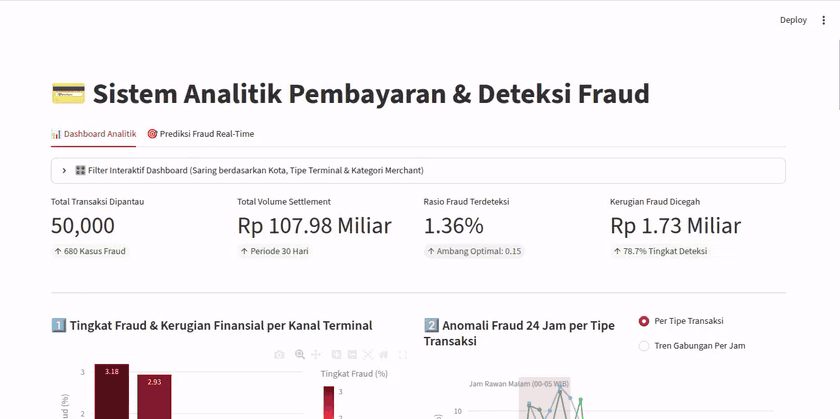

# 💳 Payment Analytics & Fraud Detection System

[](https://www.python.org/)
[](https://spark.apache.org/)
[-10B981)](https://scikit-learn.org/)
[](https://fastapi.tiangolo.com/)
[](https://streamlit.io/)
[](https://public.tableau.com/)

End-to-end **Payment Fraud Detection & Merchant Behavioral Analytics** platform across **EDC terminals, QRIS, and Online Payment Gateways** (**50,000 transactions**, **Rp 107.98B volume**, **1,500 merchants**).

---

## 🎬 Live System Demo



> 📹 **Video File:** [reports/figures/demo.mp4](reports/figures/demo.mp4)

---

## 🎯 Core Business Problems Solved

1. **Chargeback Loss vs. Customer Friction Trade-Off:** Replaced static rules with a **Stacking Ensemble (XGBoost + LightGBM + Random Forest)** and a **3-tier cost-calibrated decision engine** (`APPROVE < 0.15`, `STEP-UP 2FA OTP 0.15–0.37`, `AUTO-BLOCK >= 0.37`), mitigating **78.7% of fraud exposure (Rp 1.73B)**.
2. **Structured + Unstructured POS Telemetry Fusion:** Combined 24-hour rolling velocity windows (`PySpark`), balance depletion ratios, and **NLP security flags** extracted from raw EDC device telemetry logs (`device_remarks`).
3. **Merchant Risk & SLA Differentiation:** Segmented **1,500 merchants** into **4 actionable behavioral clusters** via **K-Means + PCA (`Silhouette = 0.6623`)** to tailor settlement limits, nocturnal filters, and hardware audits.

---

## 📊 Key Results & Insights

### 1. Model Benchmark (Held-Out Test Set & 3-Fold CV)

| Model | CV ROC-AUC | CV PR-AUC | Test PR-AUC | Test Precision | Test Recall | Test F1 |
|---|---|---|---|---|---|---|
| Logistic Regression | 0.9794 | 0.7774 | 0.7396 | 15.6% | 94.1% | 0.267 |
| Random Forest | 0.9815 | 0.8163 | 0.7843 | 13.3% | 95.6% | 0.233 |
| LightGBM | 0.9823 | 0.8467 | 0.8300 | 42.3% | 83.1% | 0.561 |
| XGBoost | 0.9842 | 0.8541 | 0.8335 | 41.1% | 83.1% | 0.550 |
| **Stacking Ensemble (XGB+LGB+RF)** | **0.9845** | **0.8547** | **0.8336** | **75.4%** | **78.7%** | **0.770** |

### 2. Merchant Behavioral Segments (K-Means + PCA)

| Segment | Merchants | Avg Volume | Nocturnal Ratio | Mobile/Online | Fraud Rate | Recommended Action |
|---|---|---|---|---|---|---|
| **High-Volume Enterprise Retailers** | 351 (23.4%) | Rp 234.95M | 6.4% | 16.3% | 0.95% | Dedicated Key Account Manager & priority daily settlement SLA |
| **Mobile POS & High-Velocity** | 343 (22.9%) | Rp 55.25M | 22.4% | 80.3% | **2.44%** | GPS geofencing, velocity rate-limiting & 2FA step-up on high-ticket transfers |
| **Night-Active Hospitality** | 280 (18.7%) | Rp 16.85M | **53.6%** | 29.4% | 2.10% | Calibrate nocturnal risk (`00:00–05:00 WIB`) filters & deploy dynamic QRIS |
| **Standard Everyday Retail** | 526 (35.1%) | Rp 3.51M | 4.6% | 10.3% | **0.32%** | Automated settlement & quarterly preventive EDC maintenance |

### 3. Top Dashboard Findings
- **Channel Risk:** `EDC_MOBILE` (**2.44%**) and `ONLINE_PG` (**2.12%**) show **4×–7× higher fraud** than static retail terminals (`0.32%`).
- **Nocturnal Surge (`00:00–05:00 WIB`):** Fraud spikes to **10%–12.5%** specifically on nocturnal `TRANSFER` & `CASH_OUT`, while retail `PAYMENT` stays `< 1%`.
- **Top Predictive Signals:** Origin balance depletion (`is_account_emptied` — **16.8%**), NLP telemetry keywords (`device_risk_flag_count` — **12.0%**), and settlement balance discrepancies (`error_balance_dest` — **10.1%**).

---

## 🚀 Quickstart

```bash
# 1. Install dependencies & run full pipeline (ETL -> Features -> Clustering -> Ensemble -> Tests)
pip install -r requirements.txt
bash run_all.sh

# 2. Launch Interactive Dashboard & Real-Time Prediction Simulator (http://localhost:8501)
streamlit run app.py

# 3. Launch FastAPI Scoring Microservice (http://localhost:8000/docs)
uvicorn api.main:app --host 0.0.0.0 --port 8000
```
